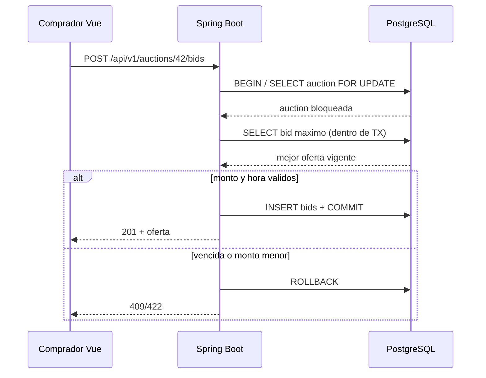

# Flujos completos del MVP: actores, pasos, excepciones y datos

**Proyecto:** SubastaWeb · **ID:** FLOW-SW-004 · **Versión:** 4.0 · **Fecha:** 30/10/2026

**Equipo:** 12 estudiantes: PO-01, PO-02, SM-01 y D01-D09. **Stack:** Vue 3 + Vite, Java + Spring Boot y PostgreSQL. **Duración:** 4 sprints de una semana.

**Estado:** Borrador técnico para validación por PO principal. 

## Diagrama de ciclo general

La publicación no recibe pujas hasta superar moderación. La fecha final se crea al aprobar, no al publicar la solicitud. Las validaciones de puja ocurren bajo bloqueo transaccional.

## FL-01 - Registro e inicio de sesión

**Actor:** Visitante / USER · **Componentes:** Vue, Spring Boot, PostgreSQL · **Interfaz:** `POST /auth/register, POST /auth/login` · **HU:** HU-01,HU-02,HU-03.

**Precondición:** No requiere sesión anterior.

**Secuencia nominal:**

1. El visitante valida campos y solicita alta.
2. Spring normaliza correo, comprueba duplicados y guarda hash con rol USER.
3. Se autentica por contraseña; servidor emite cookie de sesión segura.
4. Vue consulta /auth/me y habilita vistas privadas.

**Excepciones y reglas alternativas:**

- Duplicado -> 409; datos inválidos -> 422; contraseña errónea -> 401.

**Efectos sobre datos:** users; cookie de sesión.

**Validación:** reproducir el escenario principal, caso negativo y restricciones de visibilidad/rol.

## FL-02 - Solicitud de publicación

**Actor:** USER · **Componentes:** Vue, Spring Boot, PostgreSQL · **Interfaz:** `POST /auctions (multipart)` · **HU:** HU-04.

**Precondición:** El actor tiene permisos; el módulo previo y sus contratos están integrados.

**Secuencia nominal:**

1. USER completa artículo, categoría, precio, duración e imagen.
2. API verifica sesión, valida imagen, asigna storage_key y persiste auctions.
3. Estado PENDIENTE_REVISION, ronda=1, fechas sin iniciar.
4. Guarda evento ENVIADA y muestra confirmación solo al vendedor.

**Excepciones y reglas alternativas:**

- Imagen inválida -> 422 y limpiar archivo temporal; no autenticado -> 401.

**Efectos sobre datos:** auctions,auction_images,auction_status_events.

**Validación:** reproducir el escenario principal, caso negativo y restricciones de visibilidad/rol.

## FL-03 - Aprobar o rechazar

**Actor:** ADMIN · **Componentes:** Vue, Spring Boot, PostgreSQL · **Interfaz:** `GET /admin/auctions/pending; POST /admin/auctions/{id}/review` · **HU:** HU-07,HU-08.

**Precondición:** El actor tiene permisos; el módulo previo y sus contratos están integrados.

**Secuencia nominal:**

1. ADMIN abre cola y examina ronda/version.
2. Backend verifica ADMIN, bloquea fila y comprueba pendiente.
3. APROBAR: registra decisión y activa starts_at/ends_at calculadas por servidor.
4. RECHAZAR: exige motivo, guarda decisión y estado RECHAZADA.
5. Guarda evento de transición y confirma transacción.

**Excepciones y reglas alternativas:**

- Otro ADMIN ya decidió -> 409; USER -> 403; rechazo sin razón -> 422.

**Efectos sobre datos:** auctions,moderation_reviews,auction_status_events.

**Validación:** reproducir el escenario principal, caso negativo y restricciones de visibilidad/rol.

## FL-04 - Corregir y reenviar

**Actor:** USER propietario · **Componentes:** Vue, Spring Boot, PostgreSQL · **Interfaz:** `PATCH /auctions/{id}; POST /auctions/{id}/resubmit` · **HU:** HU-05,HU-06.

**Precondición:** El actor tiene permisos; el módulo previo y sus contratos están integrados.

**Secuencia nominal:**

1. Vendedor consulta Mis subastas y ve causa de rechazo.
2. Edita RECHAZADA: incrementa content_version y guarda imagen/campos nuevos.
3. Reenvía: servidor exige versión nueva y cambia a PENDIENTE_REVISION.
4. Incrementa review_round y registra evento REENVIADA.

**Excepciones y reglas alternativas:**

- Sin cambios -> 409; otro usuario -> 403/404; ACTIVA no editable -> 409.

**Efectos sobre datos:** auctions,auction_images,auction_status_events.

**Validación:** reproducir el escenario principal, caso negativo y restricciones de visibilidad/rol.

## FL-05 - Puja ascendente concurrente

**Actor:** USER comprador · **Componentes:** Vue, Spring Boot, PostgreSQL · **Interfaz:** `POST /auctions/{id}/bids` · **HU:** HU-10,HU-11.

**Precondición:** El actor tiene permisos; el módulo previo y sus contratos están integrados.

**Secuencia nominal:**

1. El frontend muestra precio y mínimo estimado; no decide validez final.
2. API adquiere bloqueo de auctions bajo transacción.
3. Después del lock confirma ACTIVA, reloj servidor, usuario distinto de vendedor.
4. Consulta oferta máxima actual y valida nueva cantidad.
5. Inserta bid y confirma; UI actualiza historial y precio.

**Excepciones y reglas alternativas:**

- Concurrencia y monto insuficiente -> 409; no autenticado -> 401; auto-puja -> 403; datos inválidos -> 422.

**Efectos sobre datos:** bids; auctions bloqueada sin precio redundante.

**Validación:** reproducir el escenario principal, caso negativo y restricciones de visibilidad/rol.

## FL-06 - Cierre automático y resultado

**Actor:** Sistema / Visitante · **Componentes:** Vue, Spring Boot, PostgreSQL · **Interfaz:** `@Scheduled, GET /auctions/{id}/result` · **HU:** HU-12,HU-13,HU-14.

**Precondición:** El actor tiene permisos; el módulo previo y sus contratos están integrados.

**Secuencia nominal:**

1. Job busca ACTIVA con ends_at vencido.
2. Bloquea cada fila y revalida status y reloj de servidor.
3. Selecciona bid más alto o NULL; actualiza estado FINALIZADA y closed_at.
4. Registra evento FINALIZADA en misma transacción.
5. Visitante consulta alias ganador y monto, o mensaje Sin ofertas.

**Excepciones y reglas alternativas:**

- Dos jobs ejecutados -> transición única; puja tardía -> rechazo incluso antes de que corra job.

**Efectos sobre datos:** auctions.winning_bid_id,auctions.closed_at,auction_status_events.

**Validación:** reproducir el escenario principal, caso negativo y restricciones de visibilidad/rol.

## Secuencia de puja concurrente (Mermaid editable)

## Pruebas de aceptación por flujo

| Flujo | Pruebas | Evidencia |
| --- | --- | --- |
| FL-01 | TC-01, TC-02, TC-03 | Auth + roles en API y UI |
| FL-02 | TC-04 | Solicitud pendiente privada en PostgreSQL |
| FL-03 | TC-08, TC-09, TC-10, TC-11 | Revisión única y acta |
| FL-04 | TC-05, TC-06, TC-07 | Nueva ronda y cambio requerido |
| FL-05 | TC-14, TC-15, TC-16, TC-17 | Resultado de 20 peticiones paralelas |
| FL-06 | TC-18 a TC-23 | Cierre repetido y ganador/NULL |

**Fuentes visuales:** Los diagramas PNG y SVG y sus Mermaid editables se encuentran en la carpeta `08_Diagramas`.
